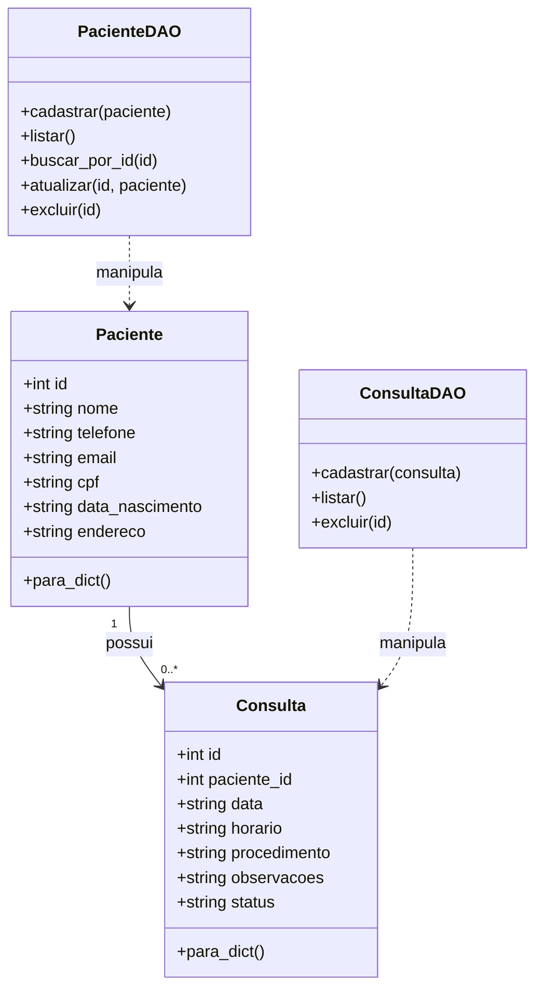

# Sorriso Fácil — Sistema de Clínica Odontológica

Projeto Integrado de DWS + POO + Banco de Dados.

## 1. O que o sistema faz
- Cadastra, lista, edita e exclui pacientes.
- Agenda e lista consultas.
- Permite excluir consultas.
- Mostra o total de pacientes e consultas.
- O JavaScript conversa com o Python por meio de rotas Flask e `fetch()`.

## 2. Tecnologias
- HTML: estrutura das páginas.
- CSS: aparência do site.
- JavaScript: ações da tela e chamadas `fetch`.
- Python + Flask: servidor e rotas da API.
- POO: classes `Paciente` e `Consulta`.
- DAO: classes `PacienteDAO` e `ConsultaDAO`, responsáveis pelo SQL.
- SQLite: banco de dados local.

## 3. Como executar
1. Instale Python 3.
2. Abra o terminal dentro da pasta do projeto.
3. (Opcional, recomendado) Crie um ambiente virtual:
   - Windows: `py -m venv .venv`
   - Windows: `.venv\\Scripts\\activate`
4. Instale as dependências: `pip install -r requirements.txt`
5. Inicie: `python app.py` (ou `py app.py` no Windows).
6. Abra no navegador: `http://127.0.0.1:5000`

O arquivo `clinica.db` e suas tabelas são criados automaticamente na primeira execução.
O arquivo `banco.sql` também contém os comandos SQL para criar as tabelas manualmente.

## 4. Organização dos arquivos
- `app.py`: inicia o Flask e conecta as partes do sistema.
- `database.py`: abre a conexão e cria as tabelas.
- `models.py`: classes que representam Paciente e Consulta.
- `dao.py`: comandos de cadastro, consulta, edição e exclusão no banco.
- `routes.py`: rotas da API.
- `templates/index.html`: estrutura da página.
- `static/style.css`: visual do site.
- `static/script.js`: interações e Fetch.
- `banco.sql`: criação das tabelas.

## 5. Diagrama de classes (UML)

## 6. Estrutura do banco
### Tabela `pacientes`
| Campo | Tipo | Regra |
|---|---|---|
| id | INTEGER | Chave primária, autoincremento |
| nome | TEXT | Obrigatório |
| telefone | TEXT | Obrigatório |
| email | TEXT | Opcional |
| cpf | TEXT | Único |
| data_nascimento | TEXT | Opcional |
| endereco | TEXT | Opcional |

### Tabela `consultas`
| Campo | Tipo | Regra |
|---|---|---|
| id | INTEGER | Chave primária, autoincremento |
| paciente_id | INTEGER | Chave estrangeira |
| data | TEXT | Obrigatório |
| horario | TEXT | Obrigatório |
| procedimento | TEXT | Obrigatório |
| observacoes | TEXT | Opcional |
| status | TEXT | Padrão: Agendada |

Relacionamento: um paciente pode ter várias consultas. Cada consulta pertence a um paciente.

## 7. Rotas da API
| Método | Rota | Função |
|---|---|---|
| GET | `/api/pacientes` | Listar pacientes |
| POST | `/api/pacientes` | Cadastrar paciente |
| PUT | `/api/pacientes/id` | Atualizar paciente |
| DELETE | `/api/pacientes/id` | Excluir paciente |
| GET | `/api/consultas` | Listar consultas |
| POST | `/api/consultas` | Agendar consulta |
| DELETE | `/api/consultas/id` | Excluir consulta |

## 8. Como explicar ao professor
"Meu projeto é um sistema simples para uma clínica odontológica. O site permite cadastrar pacientes e agendar consultas. A parte visual foi feita com HTML e CSS. O JavaScript usa Fetch para enviar e receber informações do Python. No Python usei Flask para criar as rotas. Também usei POO, com as classes Paciente e Consulta. As classes DAO fazem a comunicação com o banco SQLite, onde ficam salvos os pacientes e as consultas."

### O que é DAO?
DAO é uma parte do programa que organiza os comandos usados para acessar o banco de dados. Assim, as rotas não precisam escrever SQL diretamente.

### O que é Fetch?
Fetch é um recurso do JavaScript que envia solicitações para o Flask sem precisar recarregar a página inteira.

## 9. Entrega pelo GitHub
1. Crie um repositório no GitHub com o nome `sorriso-facil`.
2. Envie todos os arquivos desta pasta.
3. Faça commits durante o desenvolvimento, por exemplo:
   - `Criando estrutura inicial do projeto`
   - `Adicionando banco de dados e classes`
   - `Criando rotas Flask e DAOs`
   - `Finalizando front-end com Fetch`
4. No GitHub, abra **Settings > Collaborators > Add people**.
5. Adicione o professor pelo e-mail `leonardo.stephan@eaportal.org`.
6. Confirme o convite.

**Importante:** o convite ao professor e os commits precisam ser feitos diretamente na sua conta do GitHub. O projeto está preparado para isso, mas essas ações não são feitas automaticamente por este arquivo.
